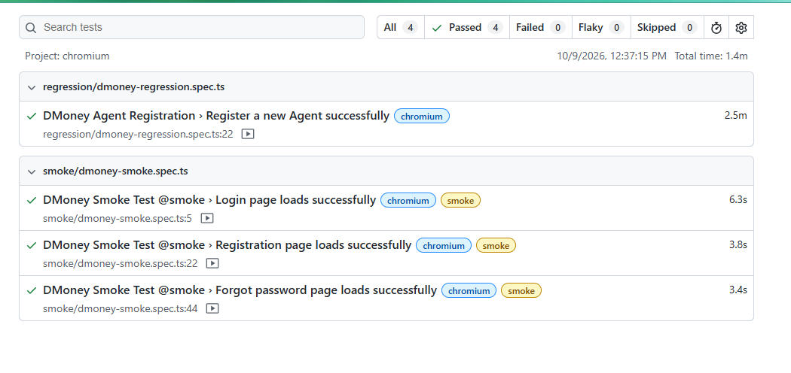
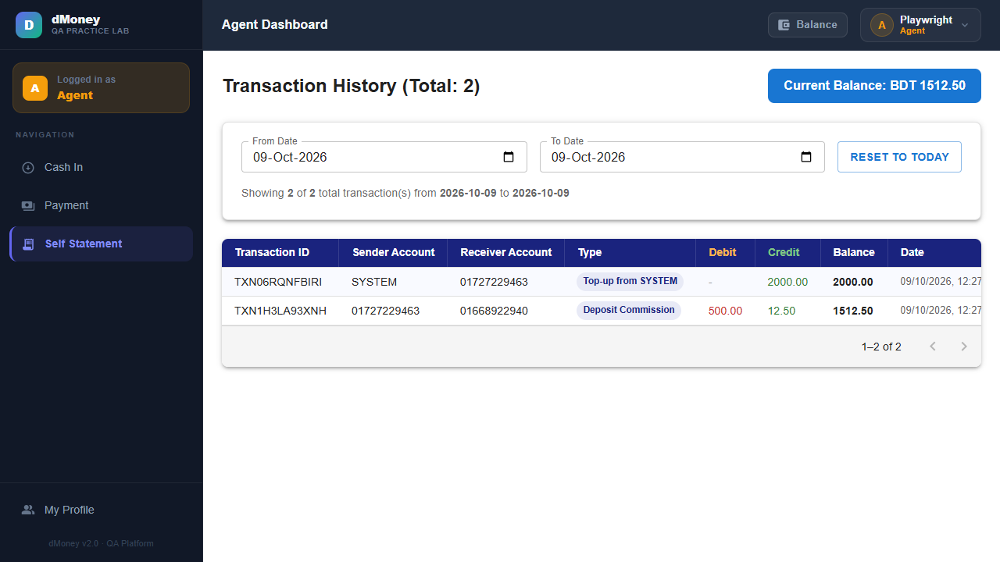
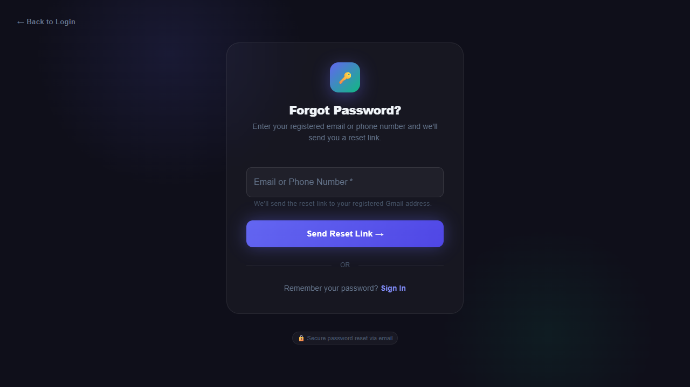
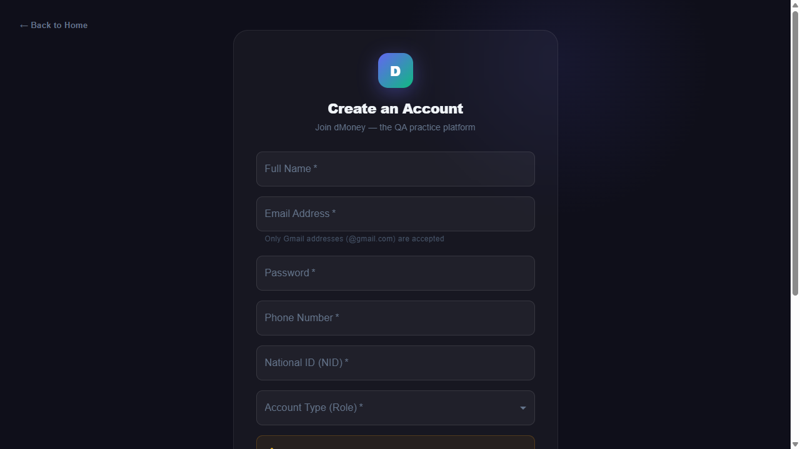
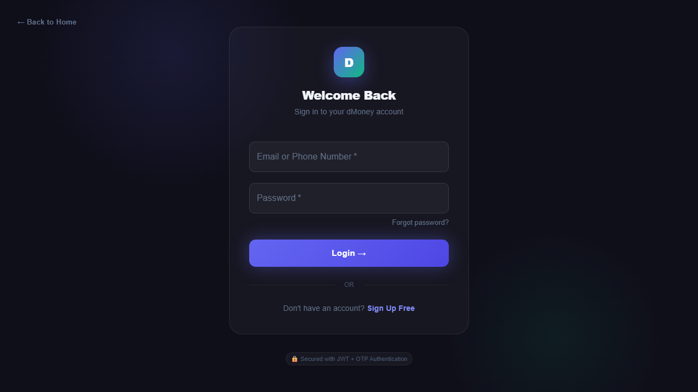

# DMoney Portal Playwright Assignment

<div align="center">


</div>

End-to-end browser automation for the DMoney QA practice portal. The regression flow uses Playwright, TypeScript, page objects, and Gmail OTP/reset-link retrieval to exercise Agent registration, approval, transactions, password reset, and statement export.

## Table of Contents

- [Workflow Coverage](#workflow-coverage)
- [Technology Stack](#technology-stack)
- [Project Structure](#project-structure)
- [Setup](#setup)
- [Run the Tests](#run-the-tests)
- [Statement CSV](#statement-csv)
- [Evidence](#evidence)
- [Notes](#notes)
- [Repository](#repository)
- [Author](#author)

## Workflow Coverage

The regression test validates the complete assignment workflow:

- Register a uniquely named Agent and verify the pending-registration message.
- Log in as Admin, find the Agent in the user list, verify the pending status, activate the account, and verify active status after reload.
- Log in as System and deposit Tk 2,000 into the Agent account.
- Log in as Agent, verify the Tk 2,000 balance, and deposit Tk 500 to an existing Customer.
- Verify the resulting Agent balance and transaction details.
- Log out, reset the Agent password, verify the old password is rejected, and log in with the new password using OTP.
- Extract all pages of the Agent Self Statement, verify both transactions, and save the data to a dated CSV file.

The smoke suite contains positive page-load checks for Login, Registration, and Forgot Password.

## Technology Stack

- Playwright Test
- TypeScript and Node.js 20+
- Chromium
- Gmail API access for login OTPs and password-reset links
- Page Object Model

## Project Structure

```text
.
|-- data/
|   `-- testData.ts
|-- docs/
|   `-- evidence/
|-- pages/
|   |-- AdminPage.ts
|   |-- AgentPage.ts
|   |-- LoginPage.ts
|   |-- PasswordResetPage.ts
|   |-- PaymentPage.ts
|   |-- SignupPage.ts
|   `-- SystemPage.ts
|-- reports/
|   `-- self_statement_2026-10-09.csv
|-- tests/
|   |-- regression/
|   |   `-- dmoney-regression.spec.ts
|   `-- smoke/
|       `-- dmoney-smoke.spec.ts
|-- utils/
|   `-- GmailClient.ts
|-- .env
|-- .gitignore
|-- package.json
`-- playwright.config.ts
```

## Setup

1. Install Node.js 20 or newer.
2. Install dependencies and the Chromium browser:

   ```sh
   npm ci
   npx playwright install chromium
   ```

3. Create a local `.env` file containing a valid Gmail API access token for the mailbox used by the Agent test account:

   ```env
   GMAIL_ACCESS_TOKEN=your_google_oauth_access_token
   ```

   The token must have permission to read the mailbox. It may expire; refresh it before a run if Gmail API requests fail. Keep `.env` private; it is excluded by `.gitignore`.

## Run the Tests

Run the complete suite, regression workflow, or smoke checks:

```sh
npm test
npm run test:regression
npm run test:smoke
```

All scripts run headed Chromium. The Playwright configuration records video and screenshots. HTML reports and raw run artifacts are written to `playwright-report/` and `test-results/`; these generated directories are ignored by Git.

## Statement CSV

The regression test extracts every Self Statement page and writes a dated CSV under `reports/`:

```text
reports/self_statement_YYYY-MM-DD.csv
```

Latest generated file: [self_statement_2026-10-09.csv](reports/self_statement_2026-10-09.csv)

## Evidence

The regression and smoke suites were run successfully on October 9, 2026: 1 regression test and 3 smoke tests passed.

### Regression Test Result

The Playwright report screenshot below shows the passing regression and smoke suites (4 passed, 0 failed). It is the generated test-result screenshot for both required result sections.





- [Regression headed video](docs/evidence/regression-video.webm)
- [Self Statement screenshot](docs/evidence/regression-result-1.png)

### Smoke Test Result

The smoke checks cover successful loads of the Login, Registration, and Forgot Password pages. The combined passing-results screenshot above includes all three smoke tests.

| Login page | Registration page | Forgot Password page |
| --- | --- | --- |
|  |  |  |

- [Smoke video 1](docs/evidence/smoke-video-1.webm)
- [Smoke video 2](docs/evidence/smoke-video-2.webm)
- [Smoke video 3](docs/evidence/smoke-video-3.webm)

## Notes

- The regression test interacts with the live portal. It creates an Agent, changes account status and password, and performs the specified deposits. Run it only when those live test actions are intended.
- The Agent login and password-reset steps depend on Gmail access to the configured test mailbox.
- The test discovers existing Customer accounts and retries accounts that reject the deposit.
- The CSV output under `reports/` is generated test data and contains transaction information from the run.
- `.env`, `test-results/`, `playwright-report/`, and local screenshot output are excluded by `.gitignore`; the curated evidence in `docs/evidence/` is retained for the README.

## Repository

[DMoney Playwright Automation](https://github.com/almahmudjoy/Automation-on-Playwright)

## Author

Abdullah Al Mahmud Joy

Full Stack SDET - Road to SDET

M.Sc. in Computer Science & Engineering, Military Institute of Science and Technology (MIST)

B.Sc. in Computer Science & Engineering, Bangladesh University of Business and Technology (BUBT)

- GitHub: [https://github.com/almahmudjoy](https://github.com/almahmudjoy)
- LinkedIn: [https://linkedin.com/in/abdullah-al-mahmud-joy](https://linkedin.com/in/abdullah-al-mahmud-joy)

This project is a practical automation exercise built to validate real-world end-to-end web flows using Playwright, with emphasis on measurable QA evidence and assignment coverage.


